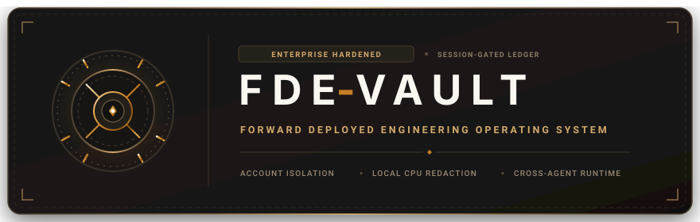

<p align="center">
  
</p>

# FDE-VAULT

<p align="center">
  <strong>Enterprise Forward Deployed Engineering Operating System and Account Ledger</strong><br />
  <em>A unified, session-gated governance system and cross-agent ledger for high-stakes enterprise deployments.</em>
</p>

<p align="center">
  
  
  
  
  
</p>

---

## Executive Summary

Forward Deployed Engineers (FDEs) operate at the volatile intersection of customer infrastructure, evolving security boundaries, and enterprise deadlines. When pairing with terminal AI tools (Claude Code, Google Antigravity, Cursor, Codex CLI), engineers risk polluting client accounts, leaking credentials across workspaces, or losing critical architectural rulings in ephemeral context windows.

**FDE-VAULT** is a production-grade operating system and skill that establishes a single, canonical, session-gated ledger (`./.fde-vault/`) across all terminal AI coding agents. It enforces client account isolation, automated credential scrubbing before network egress, and hardcover engineering journal rendering.

- **Cross-Agent Discovery:** One canonical ledger mounted simultaneously by Claude Code, Google Antigravity, Cursor, and Codex CLI.
- **Session-Gated Access:** Passphrase-gated ledger sessions powered by PBKDF2-HMAC-SHA256 (100,000 iterations).
- **Local Secret & PII Scrubbing:** CPU-side pattern redaction preventing credentials, tokens, JWTs, and PII from reaching model providers.
- **Pure Standard Library:** Zero third-party Python dependencies; runs natively on macOS, Linux, and Windows.
- **Zero Demo Data:** Ships pristine with an empty portfolio index and clean template blueprint.

---

## Installation

### macOS & Linux (One-Line Installer)

```bash
curl -fsSL https://raw.githubusercontent.com/aryamanm77/fde-vault/main/install.sh | bash
```

### Windows PowerShell (One-Line Installer)

```powershell
irm https://raw.githubusercontent.com/aryamanm77/fde-vault/main/install.ps1 | iex
```

### Python Package Manager (`pip` / `pipx`)

Install the global `fde` executable directly via Git:

```bash
pipx install git+https://github.com/aryamanm77/fde-vault.git
```

Or with standard `pip`:

```bash
python3 -m pip install --user git+https://github.com/aryamanm77/fde-vault.git
```

### Local Repository Setup

If you have cloned the repository locally:

```bash
python3 .claude/skills/fde-vault/scripts/install_cli.py
```
*(On Windows, run with `py -3` in place of `python3`.)*

The installer automatically registers the `fde` command in your shell profile (`~/.zshrc`, `~/.bashrc`, or PowerShell `$PROFILE`) and mirrors the skill to `~/.claude/skills/fde-vault/` and `~/.agent/skills/fde-vault/`.

---

## Quickstart: Scaffolding a Repository

To equip any code repository with FDE-VAULT governance without disturbing existing account data, navigate to your project and run:

```bash
cd /path/to/your/engineering-repo
fde init
```

This scaffolds the canonical architecture:
- `.fde-vault/_blueprint/` (Account template: `brain.md`, `timeline.md`, `inbox.md`, `outputs/`)
- `.fde-vault/index.json` (Empty portfolio registry)
- `.claude/skills/fde-vault/` and `.agent/skills/fde-vault/` (Skill definitions)
- `.claude/settings.json` (PreToolUse and UserPromptSubmit firewall hooks)
- `AGENTS.md`, `GEMINI.md`, `CLAUDE.md`, `.cursorrules` (Cross-agent root pointers)
- `.gitignore` (Secures active vaults while tracking templates)

---

## Interactive Terminal Experience

Typing `fde` in an interactive terminal triggers the geometric logo animation, followed by the Cover Page and Command Directory:

```text
                    ▄████████▄        
                  ▄██▀  ██  ▀██▄      ██████   █████▄   ██████
                 ██▀   ▄██▄   ▀██     ██▄▄     ██  ██   ██▄▄  
                 ██▄▄▄██████▄▄▄██     ██▀▀     ██  ██   ██▀▀  
                 ██▀▀▀██████▀▀▀██     ██       █████▀   ██████
                 ██▄   ▀██▀   ▄██     
                  ▀██▄  ██  ▄██▀      V A U L T               
                    ▀████████▀        

                       ● Ready.                        

  F D E - V A U L T
  [1/3] Mounting isolated account ledger...
  [2/3] Arming Zero-Chat-Exposure redaction engine...
  [3/3] Opening engineering journal...
```

```
======================================================================
  FDE-VAULT: Enterprise Forward Deployed Engineering Ledger
======================================================================
  Session Status : Active (TTL: 7h 48m remaining)
  Active Vault   : None (Run 'fde switch <account>' to mount)
  Store Location : ./.fde-vault/
======================================================================
```

---

## Command Reference

### Command Line Interface (`fde`)

| Command | Operational Purpose |
| :--- | :--- |
| `fde` | Launches the interactive interface, verifies session, prompts passphrase. |
| `fde init` | Scaffolds the complete vault architecture into the current repository. |
| `fde status` | Inspects active session TTL, current account, index drift, and portfolio accounts. |
| `fde lock` | Instantly seals the vault and destroys the active session token. |
| `fde switch <account>` | Mounts an account or provisions a new one from `_blueprint/`. |
| `fde ingest --clipboard` | Ingests and scrubs host clipboard contents into `inbox.md`. |
| `fde ingest --file <path> --wipe` | Ingests, scrubs, and securely shred-wipes a local file. |
| `fde reindex` | Reconciles discrepancies between `.fde-vault/` folders and `index.json`. |
| `fde render-dashboard` | Compiles the active account into a hardcover book HTML artifact. |
| `fde passwd` | Updates the master vault authentication passphrase. |

### Assistant Commands (Everyday Words in AI Chat: Antigravity, Claude Code, Cursor, Codex CLI)

When working inside Claude Code, Antigravity, Cursor, or Codex CLI, type simple everyday words directly in chat:

| Command | Everyday Meaning |
| :--- | :--- |
| `home` *(or `open`)* | Cover page, live status, and full command directory. |
| `lock` | Seals the local vault session immediately. |
| `accounts` *(or `status`, `vaults`)* | Renders high-level health report of active engagement and portfolio. |
| `select <account>` *(or `switch`, `start`)* | Switches active context; creates account directory if not present. |
| `setup` *(or `discover`)* | Conducts stakeholder, architecture, and boundary discovery interview. |
| `notes [text]` *(or `sync`, `log`)* | Processes entries from `inbox.md` into `timeline.md` and `brain.md`. |
| `check-request "<request>"` *(or `scope`)* | Evaluates proposed feature request against agreed boundaries. |
| `check-code "<proposal>"` *(or `preflight`, `guard`)* | Validates proposal against the core rules before touching code. |
| `issue "<problem>"` *(or `incident`)* | Initiates incident triage: severity, timeline, and mitigation runbook. |
| `proposal "<feature>"` *(or `rfc`)* | Drafts an engineering design proposal for architectural changes. |
| `summary` *(or `brief`, `report`)* | Prepares an executive status briefing for non-technical stakeholders. |
| `finish` *(or `handoff`, `done`)* | Generates a transition manual and hardcover book for customer teams. |
| `roadmap` *(or `steps`)* | Engagement milestone roadmap and checklist. |

---

## Interactive Hardcover Book Dashboard

Running `fde render-dashboard` compiles the active customer ledger into `outputs/dashboard.html`, styled as an archival hardcover engineering journal:

- **Archival Typography:** Archival cream paper (`#FAF7F0`), deep slate ink (`#1A1816`), and drop-cap chapter headers.
- **Interactive Page-Turning:** Clickable page transitions with keyboard Left/Right arrow navigation.
- **Zero Monospace Clutter:** Formatted strictly in structured narrative chapters with indented blockquotes for scope rulings.
- **Folio Numbering:** Running top header and centered bottom folio pagination.

---

## Security Model & Threat Boundary

*Engineers must understand the explicit boundaries of the local security architecture before deploying with client data:*

### 1. Session-Gated Isolation
All account data in `./.fde-vault/` is stored in plaintext Markdown. The master passphrase does not apply block-level disk encryption; it gates active sessions and enables the firewall hooks.
> **Requirement:** Full-disk encryption (FileVault, BitLocker, or LUKS) must be enabled on the host machine to ensure data confidentiality at rest.

### 2. Best-Effort Local Redaction
The CPU-side redaction engine (`vault_guard.py redact`) scans for:
- Cloud provider access keys (AWS, GCP, Azure, GitHub, Slack, Stripe).
- High-entropy bearer tokens, private keys, and JSON Web Tokens (JWTs).
- Basic authentication credentials embedded in URLs.
- Payment cards validated via the Luhn algorithm.
- National identification numbers (SSNs).
- Corporate email addresses and phone numbers.

*Free-text passwords and company-specific confidential naming conventions require human review of `inbox.md` prior to `/sync`.*

### 3. Execution Firewall Hooks
The system registers two native hooks in `.claude/settings.json`:
- **`UserPromptSubmit` (`pre_prompt_hook.py`):** Scans prompts before transmission to cloud model endpoints. Blocks execution if unredacted credentials or keys are detected.
- **`PreToolUse` (`pre_tool_hook.py`):** Evaluates agent tool invocations (`grep`, `read_file`, `bash`). Denies access to `./.fde-vault/` paths if the vault session is currently locked.

### 4. Firewall Operating Modes
By default, the prompt hook halts prompts containing phone numbers or email addresses. To permit communication containing contact details while strictly blocking cryptographic secrets, set:
```bash
export FDE_FIREWALL=credentials
```

---

## Canonical Directory Structure

```
.
├── .claude/
│   ├── settings.json                       # Hook configurations (PreToolUse & UserPromptSubmit)
│   └── skills/fde-vault/
│       ├── SKILL.md                        # Master skill specification
│       ├── references/
│       │   ├── core-rules.md               # Engagement & scope enforcement doctrines
│       │   └── playbooks.md                # Incident, RFC, and Preflight playbooks
│       └── scripts/
│           ├── vault_guard.py              # Core governance engine & CLI router
│           ├── pre_prompt_hook.py          # Egress redaction firewall hook
│           ├── pre_tool_hook.py            # Local session-access firewall hook
│           ├── install_cli.py              # Multi-platform shell profile installer
│           └── test_fde_vault.py           # Verification test suite (55 unit tests)
├── .agent/skills/fde-vault/                # Synced skill mirror for Antigravity & Codex
├── .fde-vault/                             # Single canonical ledger
│   ├── _blueprint/                         # Account template structure
│   │   ├── brain.md                        # Architectural charter & scope boundaries
│   │   ├── timeline.md                     # Engagement log & decisions
│   │   ├── inbox.md                        # Staging area for ingested notes
│   │   └── outputs/                        # Rendered artifacts & briefings
│   ├── index.json                          # Portfolio registry (ships clean)
│   ├── .vault.auth                         # PBKDF2-HMAC-SHA256 password hash
│   ├── .session-unlocked                   # Ephemeral session token (TTL-governed)
│   └── .active-vault                       # Pointer to active mounted account
├── assets/
│   └── fde-vault-logo.svg                  # Vector brand identity
├── fde_vault_pkg/                          # Pip/pipx installable Python package
│   ├── __init__.py
│   ├── cli.py                              # Entrypoint dispatcher ('fde' & 'fde init')
│   └── bundled/                            # Self-contained assets for runtime init
├── AGENTS.md                               # Universal agent discovery pointer
├── GEMINI.md                               # Google Antigravity discovery pointer
├── CLAUDE.md                               # Anthropic Claude Code discovery pointer
├── .cursorrules                            # Cursor IDE discovery pointer
├── install.sh                              # macOS/Linux one-line installer
├── install.ps1                             # Windows PowerShell one-line installer
├── pyproject.toml                          # PEP 621 packaging metadata
└── README.md                               # System documentation
```

---

## Verification & Test Suite

The test suite validates cryptographic hashing, session TTL enforcement, redaction patterns, firewall hooks, packaging, and strict repository hygiene (confirming zero demo accounts and zero emojis):

```bash
python3 .claude/skills/fde-vault/scripts/test_fde_vault.py
```

```
.......................................................
----------------------------------------------------------------------
Ran 55 tests in ~12s

OK (skipped=3)
```

---

## License

Distributed under the Apache 2.0 License. See standard terms for commercial and internal enterprise use.
